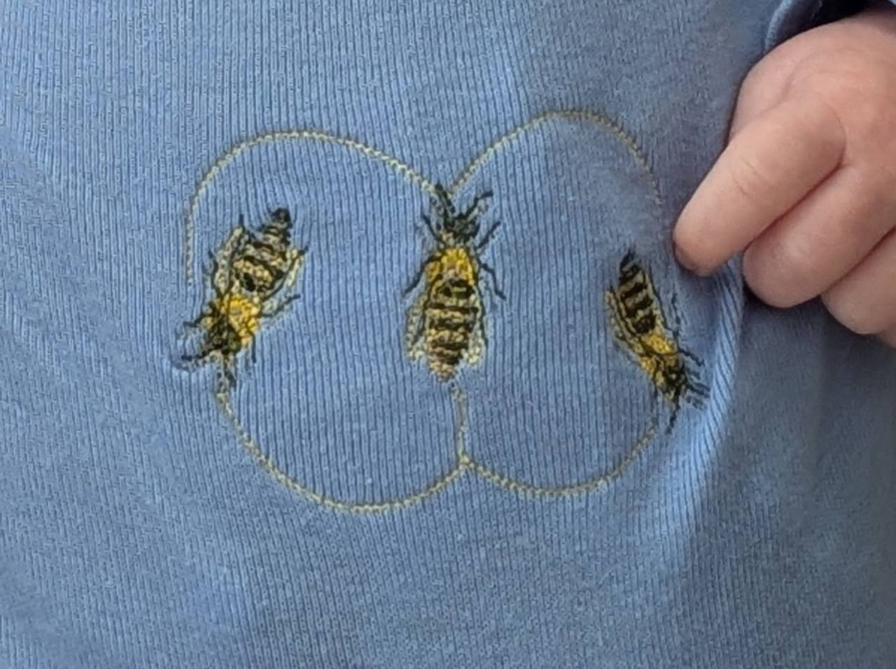
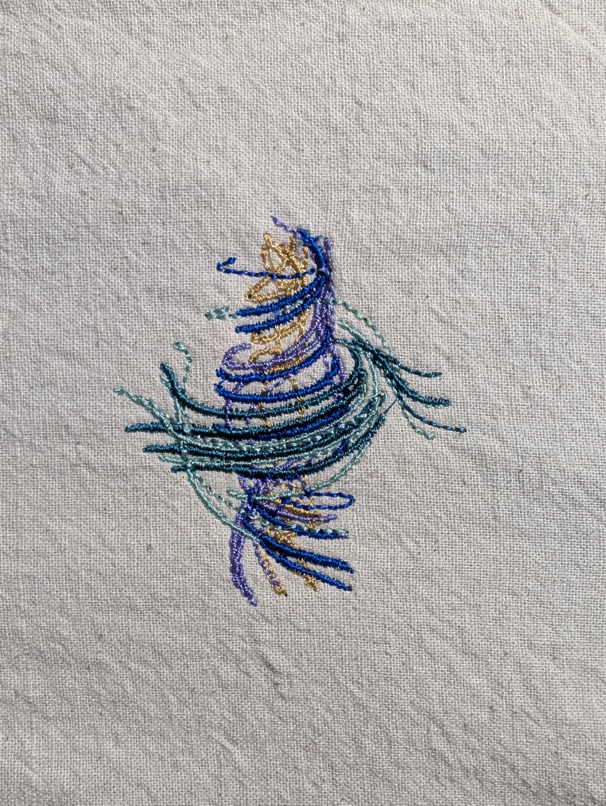
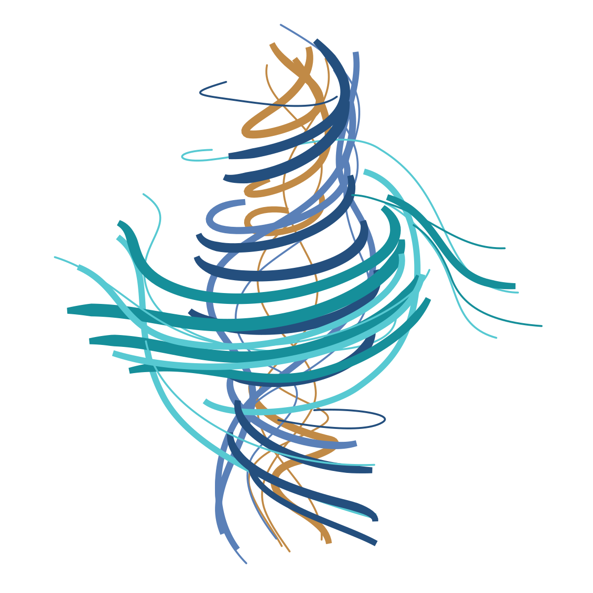

# Mara's Embroidery Library

A selected collection of machine embroidery designs, made by Mara Alexeev with Codex.

Browse the [gallery](https://MaraAlexeev.github.io/embroidery-library/) for previews, individual design pages, and downloads.

| Design | Size | Format | Testing status |
| --- | --- | --- | --- |
| [Waggle Dance](docs/patterns/waggle-dance/) | 72.8 × 49.8 mm | PES v1 | Physical test sewing pending |
| [Navier–Stokes](docs/patterns/navier-stokes/) | 80.1 × 92.1 mm | PES v1 | Successful sew-out reported; original file preserved |

Both designs are made for the Brother Skitch PP1 and fit its 100 × 100 mm / 4 × 4 inch hoop. Each package contains its machine file, editable source, software preview and instructions. Read the exact thread-loading sequence and testing notes before sewing. Design previews are software simulations; finished-piece photographs are labeled separately.

<!-- finished-embroidery:start -->
## Finished embroidery

Photographs of the physical pieces, separate from the software previews.

<strong>Waggle Dance</strong> — Completed Waggle Dance embroidery on blue knit fabric. Photograph supplied by Mara Alexeev.

<strong>Navier–Stokes</strong> — The completed Navier–Stokes embroidery on light woven fabric. Photograph supplied by Mara Alexeev.

[View the finished embroidery section](https://maraalexeev.github.io/embroidery-library/#finished-embroidery).

Photo folders: [Waggle Dance](docs/patterns/waggle-dance/photos/) · [Navier–Stokes](docs/patterns/navier-stokes/photos/). See [FINISHED_EMBROIDERY.md](FINISHED_EMBROIDERY.md) for adding selected photographs.
<!-- finished-embroidery:end -->

<!-- inspiration:start -->
## Inspiration and design artwork

<strong>Navier–Stokes</strong> — Saved design artwork: a simplified redraw made during digitizing. The original annotated inspiration image was not retained.

Reference artwork is labeled separately from physical embroidery.
<!-- inspiration:end -->

## Publishing

Only individually selected designs belong here. New designs and working files are not automatically synchronized into this repository. See [PUBLISHING.md](PUBLISHING.md).

## Website integration

The gallery is a portable static website in `docs/`. Each design has a permanent folder, preview, instruction file and ZIP URL. [catalog.json](docs/catalog.json) contains only published design information and relative asset links, so a personal website can display selected work while linking to the same downloads. It does not enumerate or access any private collection.
