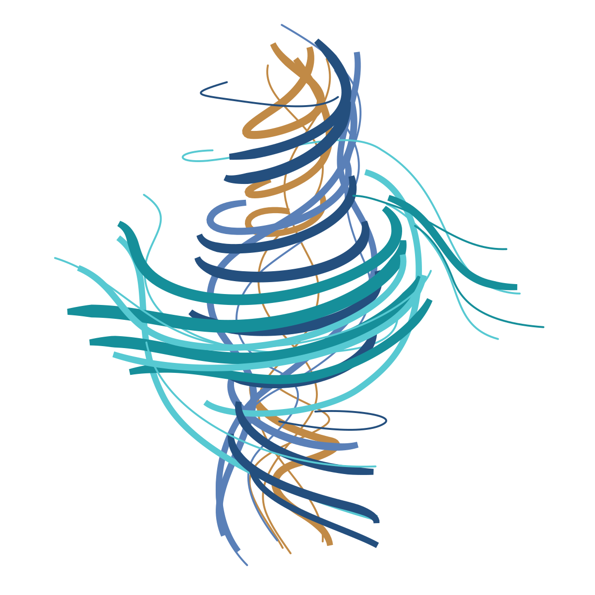
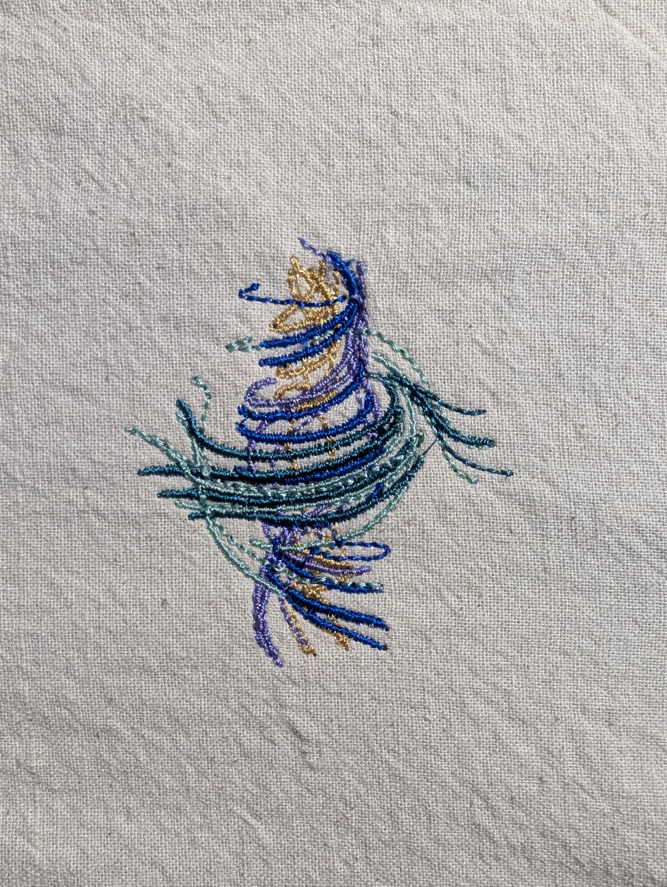

# Navier–Stokes — design notes

## Backstory and inspiration

Navier–Stokes began with a swirling reference image. The saved redraw turns that movement into intertwined ribbons in amber, blue, aqua, navy and teal, prepared for a single 100 × 100 mm hoop on the Brother Skitch PP1.

The original annotated reference image is no longer retained. The artwork below is the simplified redraw saved during digitizing. After sewing the original PES successfully, Mara chose to preserve that machine file exactly as it was.

Saved design artwork: a simplified redraw made during digitizing. The original annotated inspiration image was not retained.

## Files and variations

The ZIP contains the preserved original PES, editable SVG, software preview, original production worksheet, current instructions and a machine-command readback.

### Original — without text

No text. The original ribbon design, preserved after a successful sew-out.

[Download ZIP](Navier-Stokes-PES.zip) · [PES](ns_zigzag_1.pes) · [Editable source](ns_zigzag_1.svg) · [Instructions](README.txt)

One version is currently shared: the design without text. Additional versions, including lettering variations, will appear here when shared.

## Physical embroidery

Mara reported successfully sewing the original file and supplied this photograph of the finished embroidery on light woven fabric. The downloadable PES is preserved byte for byte.

The precise fabric, stabilizer and thread setup were not recorded. The thread colors in the photograph differ from the illustrative palette in the software preview.

The completed Navier–Stokes embroidery on light woven fabric. Photograph supplied by Mara Alexeev.

## Troubleshooting

### The machine’s color labels look different

Use the numbered sequence in the instructions and the original worksheet to plan the threads. There are six loads using five intended colors: aqua is loaded again at the end. Brother spool numbers were not verified for this original design.

### The stitch and trim counts disagree

The original worksheet reports 8,875 design stitches and 28 trims. Reading the exported PES gives 9,147 sewing points and 74 trim commands. The export includes additional anchor and travel commands; the file overview uses its readback counts.

### A start bunches on a new fabric or setup

This original contains tightly repeated anchors and cut-marked entry travel. Those commands remain because Mara successfully sewed the file and requested its preservation. Test on stabilized scrap before a new setup. Any proposed repair should be a separate, clearly named version.

### An edit changes how the design sews

Keep the preserved original available. A new export from the SVG needs checks of its initial start, every color entry and trimmed restarts, plus a new preview and appropriately named test files.

## Lessons learned

### Inspect the exported file

The production worksheet and the final PES describe different stages of the process. Reading back the machine file revealed the extra anchor and travel commands and established the counts used in the collection.

### Keep a successfully sewn original

The entry review identified repeated drops and cut-marked travel. Mara’s successful sew-out and request to preserve the file meant those commands were documented and retained, rather than silently changed.

### Separate references, previews and results

The saved redraw, software preview and physical photograph record three different stages. Keeping them separately labeled makes the changes in detail, texture and thread color visible.

