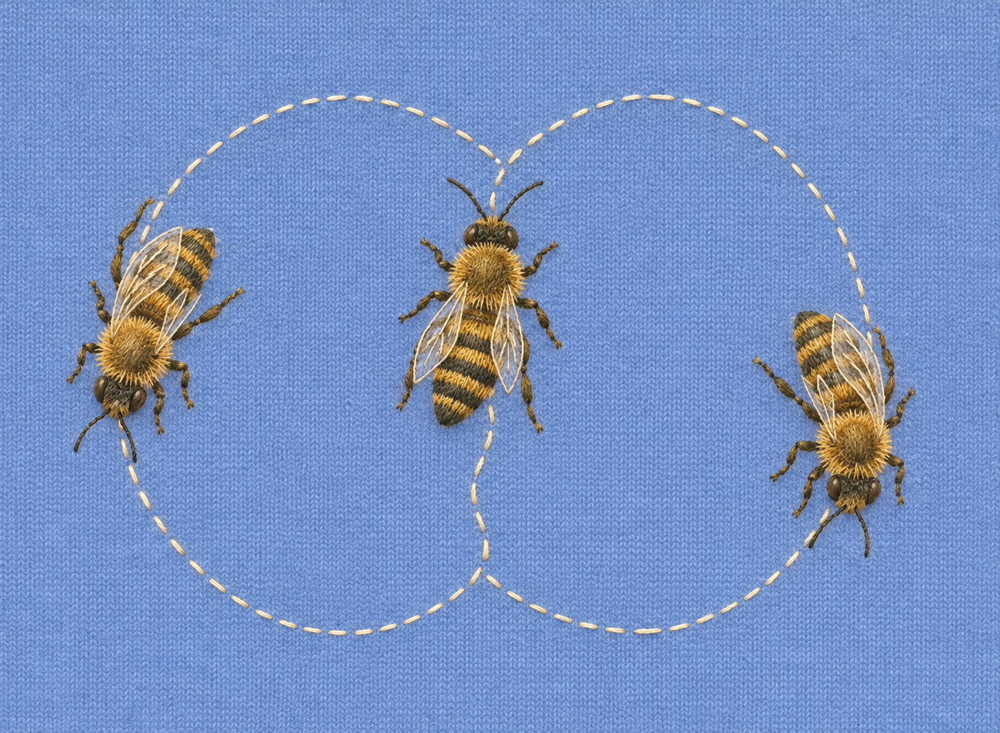
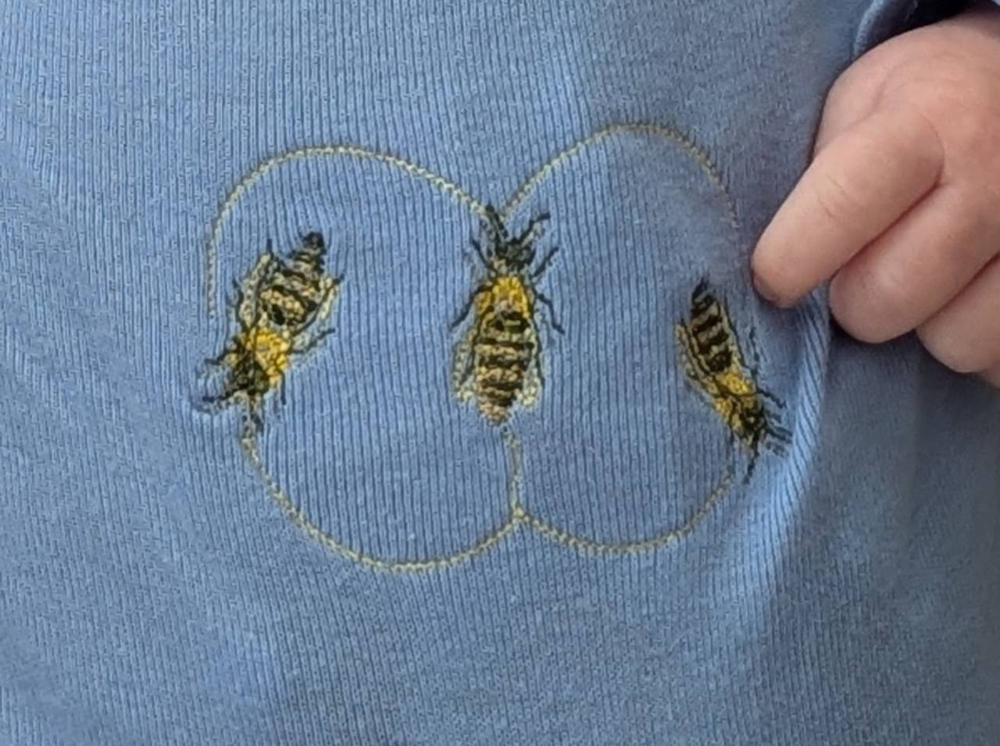

# Waggle Dance — design notes

## Backstory and inspiration

Waggle Dance began with the idea of three honeybees connected by a looping dance trail. The natural-bee concept was preferred over an earlier cartoon approach, with one bee facing upward and two turning through the return loops.

The design was planned for cornflower-blue cotton knit and a single 100 × 100 mm hoop on the Brother Skitch PP1. The bees needed to remain recognizable at a small scale, so the detailed concept became a lighter arrangement of stripes, fine legs, open wings and a continuous trail.

Approved natural-honeybee concept illustration. This planning image guided the digitizing; it is not a photograph or a machine stitch preview.

## Files and variations

The main design, four short entry tests, editable and stitch-level SVGs, a software preview, instructions and command checks are included in the ZIP.

### Original — without text

No text. Three bees and their looping trail, in one hooping.

[Download ZIP](Waggle-Dance-PES.zip) · [PES](Waggle-Dance-v1.pes) · [Editable source](Waggle-Dance-editable.svg) · [Instructions](README.txt)

One version is currently shared: the design without text. Additional versions, including lettering variations, will appear here when shared.

## Physical embroidery

The finished piece below shows the bees and trail sewn on blue knit fabric. Mara supplied this photograph for the collection.

The design was planned for cornflower-blue cotton knit. Stabilizer details, exact sewing settings and laundering results for the photographed piece have not been recorded.

Completed Waggle Dance embroidery on blue knit fabric. Photograph supplied by Mara Alexeev.

## Troubleshooting

### The knit puckers or stretches

Use suitable soft cut-away embroidery stabilizer according to its directions, and hoop the knit without stretching it. Try the design on matching stabilized scrap before a new garment.

### Fine details or travel threads need attention

The wings deliberately have open interiors, and the dark legs are very fine. Check contrast on your fabric. Clip remaining jump threads around the details; the file also retains intentional trims between separate objects.

### A start or color change behaves poorly

The ZIP includes four short entry tests: the initial start and all three color transitions. Use fresh stabilized scrap at the supplied size to isolate the entry before sewing the full design.

### An edited version sews differently

Re-exporting the editable SVG can change anchors and positioning travel. Check the new encoded PES, regenerate entry tests and the preview, and give the revision a distinct filename and import label.

## Lessons learned

### Simplify details to suit the scale

Fine fur and wing veins from the concept were simplified for bee bodies about 20 mm long. Sparse gold strokes suggest hair, while open wing interiors let the fabric show through.

### A continuous trail reduces loose ends

The concept’s isolated dashes became a fine double-running trail, interrupted around the bees. This avoids the many short jump threads that separate stitched dashes would create.

### Build adjacent color areas

The dark and honey-colored abdomen regions sit beside one another rather than forming two complete overlapping fills. Khaki supplies softer honey-brown bands from the available thread set.

### Keep the export checks with the design

The final start, all three color changes and 52 trimmed restarts were reviewed. Intentional anchors and trims were retained. The entry tests preserve the exact transitions for later checks.

